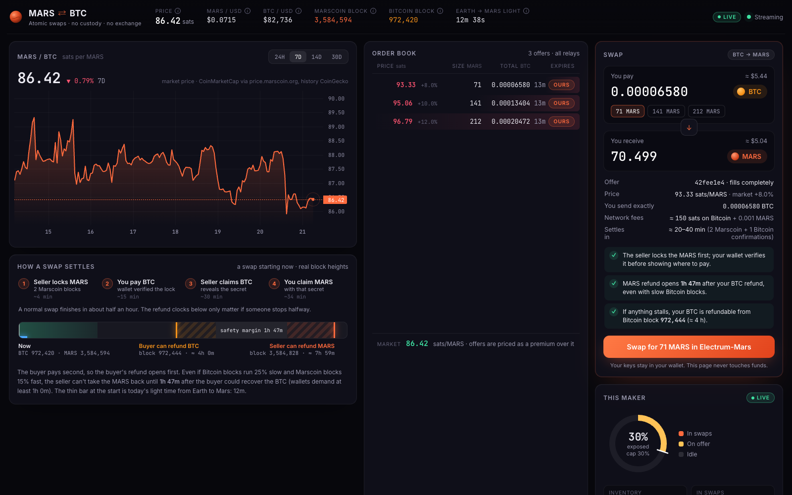

# atomicswapd

A headless market maker for **BTC ↔ MARS atomic swaps**.

`atomicswapd` is the first maker on an open exchange, not the exchange itself. The exchange is the protocol: the order book relayed by Marscoin's ElectrumX servers, plus hash time-locked contracts (HTLCs) on both chains. Anyone with an [Electrum-Mars](https://github.com/marscoin/electrum-mars) wallet can take an offer, and anyone can run this daemon to make their own.

[](https://swaps.marscoin.org)

*The first maker, live at [swaps.marscoin.org](https://swaps.marscoin.org): real offers on the Marscoin relays, both chains, and a quote for each offer with the checks a 4.4.2+ wallet makes.*

> **Status: first release.** Runs on mainnet: Marscoin has no public test network to swap against. The daemon starts in **watch** mode, with a real wallet and real data, posting and locking nothing. Switching to **live** is one setting. Keep the hot wallet small.

## How a swap works

1. The maker posts an offer to the ElectrumX order book: so much MARS for so much BTC.
2. A buyer's wallet accepts it. Nothing is paid yet.
3. **The maker locks the MARS first**, in a lockbox only the buyer can open with a secret. The maker can take it back after about 8 hours (234 Marscoin blocks).
4. The buyer's wallet checks that lock against its own copy of the Marscoin chain. Only then does it show where to send BTC. That lockbox refunds the buyer after about 4 hours (24 Bitcoin blocks).
5. The maker claims the BTC, which reveals the secret on the Bitcoin chain.
6. The buyer's wallet reads the secret and claims the MARS.

Either both sides happen or neither does. The shorter Bitcoin refund protects the buyer, who pays second. Electrum-Mars 4.4.2 and later enforce every check above.

## What the daemon does

- Runs an Electrum-Mars wallet without a GUI and drives its swap engine: posting offers, locking MARS, claiming BTC, refunding stalled swaps.
- Watches Bitcoin through mempool.space's public API, so no Bitcoin node is needed. A second source checked before each claim is planned.
- Publishes a read-only JSON API and a public dashboard: the live order book, inventory, and every completed swap with links to both transactions, plus success and refund rates.
- Planned: a chat agent that answers questions about the market and explains why a swap is waiting. **The public agent will be read-only.** It cannot change limits or touch the wallet.

## Safety rules

These are requirements, not settings:

- **Maker locks first, always.** The maker locks MARS only after seeing a valid acceptance, and claims BTC only after the buyer's lockbox is funded. If a Bitcoin API is down or lies, the worst case is a stalled swap and a refund. Swapping the order (buyer locks first) would let a lying API cost the maker real MARS, so it stays this way while there's no Bitcoin node.
- **No late claims.** The maker never claims BTC within 3 blocks of the buyer's refund.
- **Bounded exposure.**
  - At most 30% of inventory locked in pending swaps at once.
  - One pending swap per buyer (per ElectrumX client tag).
  - Small offers by default, with bigger limits for buyers who have completed swaps before.
- **No raw IP addresses.** Abuse limits use the keyed client tags the relay servers provide.
- **Hot wallet only.** The daemon holds only the inventory it is selling. Profits are swept out.
- **The operator interface is private** and separate from anything the public can reach.

## Architecture

```
          ElectrumX order book (offers, acceptances)
                         │
   ┌─────────────────────┴─────────────────────┐
   │                atomicswapd                │
   │  Electrum-Mars wallet + swap engine       │
   │  inventory and abuse limits               │
   │  Bitcoin watcher: mempool.space + Blockstream
   │  read-only JSON API ──► dashboard, chat agent
   └───────────────────────────────────────────┘
        │                                │
   Marscoin chain                   Bitcoin chain
```

The swap logic lives in Electrum-Mars (`electrum_mars/plugins/atomic_swap`). This daemon packages it for servers and adds operations: limits, monitoring, the API and the dashboard. Protocol changes go to Electrum-Mars first, so desktop wallets and the daemon always agree.

## Run your own maker

Anyone can run a maker. It takes about 15 minutes of your time and an hour of waiting while the node downloads Marscoin's block headers. You need:

- some MARS to sell (at least about **700 MARS**: with the default 30% exposure cap, the Auto-Maker's 200 MARS minimum per round means an inventory of 667 MARS or more)
- a Bitcoin address you control, for the proceeds
- somewhere to run one small Linux container: fly.io (below), any VPS, or a home server

AI agents: see [AGENTS.md](AGENTS.md) for the same procedure with checks at every step.

### On fly.io (about $6 a month)

[Install flyctl](https://fly.io/docs/flyctl/install/), run `fly auth login`, clone this repo, and pick a unique app name. Each step below says what you should see.

**1. Deploy.**

```sh
deploy/fly.sh my-mars-maker          # app, 3 GB volume, random wallet password, deploy
```

The script is safe to run again. It generates the wallet password on your machine, stores it as a fly secret and never prints it. Your dashboard is now at `https://my-mars-maker.fly.dev`, in **watch** mode.

**2. Speed up the first sync (optional, recommended).** On first start the node downloads and checks about 3.6 million Marscoin block headers. On fly's shared CPU this crawls (about 4 hours), because shared CPUs are throttled under sustained load. A dedicated CPU does it in about 30 minutes, for a few cents:

```sh
fly scale vm performance-1x --memory 2048 -a my-mars-maker     # while syncing
fly scale vm shared-cpu-1x --memory 1024 -a my-mars-maker      # once the top bar no longer says "Syncing"
```

**3. Create the hot wallet.** Either print the seed once and write it down:

```sh
fly ssh console -a my-mars-maker -C "atomicswapd wallet create"
```

or write it to a private file, copy it off, and delete it (handy when someone else runs the commands):

```sh
fly ssh console -a my-mars-maker -C "atomicswapd wallet create --seed-file /data/seed-backup.txt"
fly ssh sftp get /data/seed-backup.txt -a my-mars-maker      # keep it offline
fly ssh console -a my-mars-maker -C "rm /data/seed-backup.txt"
```

**4. Load the wallet and set where the BTC goes.**

```sh
fly apps restart my-mars-maker                                        # the daemon opens the wallet on start
fly secrets set ATOMICSWAPD_BTC_ADDRESS=bc1q... -a my-mars-maker      # your payout address
```

**5. Fund it.** Send MARS to the deposit address on the dashboard. Send a few MARS first to check your wallet can send to a `mars1` address. After each deposit the dashboard shows a fresh address; all of them belong to the maker's wallet. The balance appears once the headers are synced. Watch the setup stage:

```sh
atomicswapd status https://my-mars-maker.fly.dev     # or: curl -s .../api/snapshot | jq .setup
```

**6. Choose a spread and go live.** When the stage is `ready`, look at **Would post now** on the dashboard. The default floor is 5% over the market price (tiers at +5%, +7%, +9%). To change it, and to go live:

```sh
fly secrets set ATOMICSWAPD_FEE_PERCENT=8 ATOMICSWAPD_MODE=live -a my-mars-maker
```

Within a minute your offers appear in the order book, marked **OURS**, and `atomicswapd status` says `live` (it exits 0 only when live). Offers refresh every 5 minutes at the current price and expire after 15 unless refreshed.

**Day to day:**
- **Pause:** `fly secrets set ATOMICSWAPD_MODE=watch -a my-mars-maker`. Swaps already in progress still finish or refund.
- **Logs:** `fly logs -a my-mars-maker`.
- **Update:** pull this repo and run `deploy/fly.sh my-mars-maker` again. Headers, wallet and swaps live on the volume and survive deploys.
- **Your own domain:** `fly certs add swaps.example.org -a my-mars-maker`, then a DNS-only CNAME from `swaps.example.org` to `my-mars-maker.fly.dev`. The certificate is issued within minutes.

**If something's off:**

| What you see | Why, and what to do |
|---|---|
| Top bar says "Syncing" for hours | Shared-CPU throttling. Do step 2. |
| Stage `needs_wallet` after creating one | The daemon opens the wallet at start. `fly apps restart`. |
| Stage `wallet_error` | Usually a different `ATOMICSWAPD_WALLET_PASSWORD` than the wallet was created with. Don't create a new wallet over the old one. |
| `needs_funds` although you sent MARS | Wait for a block, and for the sync to finish. Below 667 MARS nothing is posted with the default 30% cap. |
| Live, but no offers | Check `.market.error` in `/api/snapshot`. Without a fresh price the maker posts nothing, by design. |

### With Docker anywhere

```sh
docker build -t atomicswapd .
docker volume create swapdata
umask 077 && printf 'ATOMICSWAPD_WALLET_PASSWORD=%s\n' "$(openssl rand -hex 32)" > maker.env
docker run -d --name maker --restart unless-stopped -p 8080:8080 -v swapdata:/data --env-file maker.env atomicswapd
```

`maker.env` holds the wallet password (readable only by you); the container needs it on every start. Then:

1. Create the wallet: `docker exec maker atomicswapd wallet create --seed-file /data/seed-backup.txt`. Copy the seed out with `docker cp maker:/data/seed-backup.txt .`, store it offline, and delete both copies.
2. Add `ATOMICSWAPD_BTC_ADDRESS=bc1q...` to `maker.env`, then recreate the container (`docker rm -f maker` and the `docker run` line again).
3. Fund the wallet and wait until `docker exec maker atomicswapd status` says `ready`.
4. Add `ATOMICSWAPD_MODE=live` to `maker.env` and recreate the container.

Put it behind HTTPS (Caddy, nginx or a tunnel) if the dashboard is public.

### Rules for operators

- **One instance per wallet.** Two makers sharing a wallet would post duplicate offers and race each other.
- **Keep the seed offline.** The server holds the wallet file and its password, so it can always spend; the seed is how you recover elsewhere.
- **Keep the hot wallet small.** The exposure cap limits what is locked in swaps at once; anything in the wallet is at risk if the server is compromised.
- **Withdraw profits.** BTC goes straight to your payout address; move surplus MARS out with any Electrum-Mars wallet restored from the seed. Stop the maker first: `ATOMICSWAPD_MODE=watch`.
- **Back up the volume** if you can. The swap database lets a restarted maker finish swaps in progress.

### Configuration

Environment variables cover the essentials:

| Variable | Meaning |
|---|---|
| `ATOMICSWAPD_WALLET_PASSWORD` | Encrypts the wallet file. Required. |
| `ATOMICSWAPD_BTC_ADDRESS` | Where BTC from swaps goes. Required for live. |
| `ATOMICSWAPD_MODE` | `watch` (default) or `live`. |
| `ATOMICSWAPD_FEE_PERCENT` | Minimum spread over the market price (default 5). |
| `ATOMICSWAPD_DATA` | Data directory (default `/data`). |
| `ATOMICSWAPD_CONFIG` | Optional TOML file for everything else. |

Everything else (spread, offer sizes, exposure cap, reserve, daily limit, relays) is in [`atomicswapd.example.toml`](atomicswapd.example.toml), with the defaults.

### API

All read-only:
- `GET /api/snapshot`: everything the dashboard shows, including `setup` (stage and next step).
- `GET /api/stream`: the same snapshot as server-sent events, on every change.
- `GET /api/history`: 30 days of hourly MARS/BTC and MARS/USD market prices.
- `GET /healthz`

No keys, secrets or swap preimages are ever part of a response.

### Development

```sh
pip install -e '.[dev]'     # plus Electrum-Mars, e.g. pip install -e ../electrum-mars
pytest
atomicswapd --no-node       # dashboard on real relay and market data, no wallet
cd web-src && npm install && npm run dev
```

## Milestones

1. **First maker (this release).**
   - Headless daemon on mainnet, built on the Electrum-Mars swap engine.
   - Exposure cap, a daily limit from real history, one swap per buyer.
   - Live read-only API and dashboard.
   - Docker image and fly.io deployment.
2. **Hardening.**
   - A second Bitcoin data source (Blockstream) checked before each claim.
   - A written threat model.
   - Alerts to the operator.
   - Better limits for repeat buyers.
3. **Two-way market**: buying MARS for BTC as well as selling it.

## Related

- [Electrum-Mars](https://github.com/marscoin/electrum-mars): the wallet and swap engine
- [Marscoin ElectrumX](https://github.com/marscoin/electrumx): the servers that relay the order book
- [Atomic swaps on Marscoin](https://marscoin.org/academy/atomic-swaps): how swaps work, for users
- [InterPlanetary Atomic Swaps](https://marscoin.org/academy/ipas): the research paper behind this work

## License

MIT
